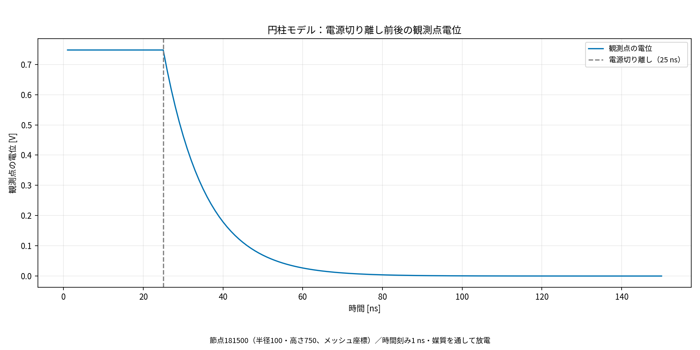

# 電源OFF時の電位応答に関する修正報告書

作成日：2026年10月29日  
対象：`/home/ohkura/test_c+/fem` のC++電位解析システム

## 1. 修正の目的と結論

電源OFF後に内部電位が負側へ振れる問題を調査し、計算実装の不具合、空間離散化の影響、電源OFFの境界条件を分けて修正した。

今回の円柱モデルについて、**電源を切り離して媒質を通じて放電する条件では、評価点の電位が正の値から0 Vへ減衰することを確認した**。全150ステップで、接地節点を含む全領域の最小電位は0 Vだった。

電源を接続したまま電圧を下げる条件も実装・検証した。この場合は設定した立下り波形に応じて電位が低下する。電源切断と電極の0 V固定では応答が異なるため、実際の回路動作に合わせて選択する。

本書は既に実施した修正と検証をまとめたものであり、本書作成のための解析の再実行は行っていない。

## 2. 負電位が生じていた原因

### 2.1 計算実装の不具合

当初の大きな負電位には、次の問題が関与していた。

- 四面体要素の形状関数勾配を、正しい逆転置行列 `J^(-T)` ではなく `J^(-1)` で変換していた。
- 電極だけをHigh、内部を0 Vとした初期化が、境界条件と整合しない人工的な初期電荷を与えていた。

これらを修正すると大きな負電位は解消したが、端面付近に約−0.168 mVの負電位が残った。

### 2.2 残留負電位を生む空間離散化誤差

今回のモデルは、XY断面、材料配置、電極条件が高さ方向に一様で、端面は零流束である。この条件では、連続体の電位は高さ方向に一定となる。

ところが三次元一次四面体による計算では、同じXY位置にある節点の初期電位に、高さ方向で最大約3.656 mVの差が生じていた。導電率は `(0.01, 0.01, 0.008) S/m`、誘電率は各方向 `1e-10 F/m` であり、この不要な高さ方向勾配が、導電率と誘電率の異方性比の違いによって過渡応答を生んでいた。

高さ方向のメッシュ間隔を20、10、5と細分化すると、OFF直後の最小電位は約−0.315、−0.168、−0.0854 mVとなった。時間刻みを変えずに誤差が減ったことから、残留負電位の主因を空間離散化に特定した。

高さ方向の同一電位を課した参照計算では、元の異方性物性を維持したまま、負電位が約 `3.1e-11 V` の数値誤差水準まで減少した。

### 2.3 電源OFFの定義

従来のパルス指定は、電源電圧が0 Vになると電極を0 Vへ固定する条件だった。この条件は電極の電荷を回路経由で放電させる「電源の切り離し」とは異なる。

電源切断後の滑らかな減衰を扱うには、電極を未知電位として、媒質の導電・変位電流と外部回路を結合する必要がある。そのため、電源の立下りと電源の切り離しを別々に指定できるようにした。

## 3. 修正・追加した機能

| 項目 | 修正内容・目的 |
|---|---|
| 四面体の勾配変換 | `J^(-T)` に修正し、任意の要素形状で正しい勾配を計算する |
| 初期電位 | 境界に整合する無自由電荷の誘電場を計算する。回路指定時は導電定常場も選択可能にした |
| 自然境界 | type 5・値0を零流束として扱い、電位を固定しない。未対応の非零流束・境界typeはエラーにする |
| 開始時刻 | `time0` を波形評価と出力時刻に反映する |
| CG収束判定 | 正の微小分母を一律に破綻と判定する処理を修正し、真の未収束時は解析を停止する |
| 出力・再計算 | 長い出力パスの切り詰めを解消。RCM並替え後の節点・境界・パルス情報を復元し、同じ解析オブジェクトでの再計算に対応する |
| 電位差モニタ | 単一モデルの実行でも `voltage_difference.dat` を読み込む |
| 高さ方向の同一電位 | `symmetry.dat` で同じXY位置の自由度をまとめ、不要な高さ方向の電位差を抑える |
| 電源・放電回路 | `circuit.dat` で電源抵抗、切断時刻、放電抵抗、外部容量、初期状態、長さ換算を指定する |
| 電荷と切替処理 | OFF時に電位・電荷を初期化し直さず、切替直前の状態を次の時間区間へ引き継ぐ |
| 行列縮約の数値精度 | 高導電率電極をまとめる際に、定数電位に対する勾配行列の零作用を保ち、相殺誤差による偽の接地経路を防ぐ |
| 回路履歴 | `circuit_history.csv` に電極電位、電極電荷、接続先基準電位、抵抗枝電流を保存する |

### 3.1 高さ方向の同一電位条件

`symmetry.dat` の内容は次のとおり。

```text
axis z
```

形状、材料配置、境界条件が高さ方向に整合する押出しメッシュを検査し、同じXY座標の節点を同一電位自由度にまとめる。出力時には元の全節点数・順序に展開する。材料の異方性は変更しない。

これは今回の一様な円柱モデルに対する対称性の利用であり、一般の三次元形状へ無条件に適用する修正ではない。

### 3.2 電源・放電回路との結合

電極を一つの未知電位として、FEM側の導電電流・変位電流と外部回路の電流収支（KCL）を同時に解く。外部容量は、FEMで既に表現されている場の容量に追加する容量である。

切り離し時刻までの区間は切断前の回路で積分し、その次の区間から切断後の回路で積分する。今回の25 ns切断では、25 nsの電極電位は1 Vを保持し、26 nsから減衰する。

## 4. 追加したモデルと使い方

プロジェクト直下で次を実行する。

```bash
./bin/fem model_entyu_open
./bin/fem model_entyu_fall_sym
./bin/fem model_entyu_clamp_sym
```

| モデル | 条件 | 出力先 |
|---|---|---|
| `model_entyu_open` | 25 nsで電源を切り離し、媒質を通じて外側接地電極へ放電 | `output/model_entyu_open/` |
| `model_entyu_fall_sym` | 電源を接続したまま25〜45 nsで1 Vから0 Vへ線形に低下 | `output/model_entyu_fall_sym/` |
| `model_entyu_clamp_sym` | 比較用。25 nsで電極を瞬時に0 Vへ固定 | `output/model_entyu_clamp_sym/` |

切り離し放電モデルの `circuit.dat` は次の設定とした。

```text
electrode_material 1
series_resistance_ohm ideal
disconnect_time_s 25e-9
off_resistance_ohm open
external_capacitance_F 0
coordinate_scale_to_m 0.001
initial_state steady
```

実機の抵抗値が未提示のため、この参照例では外部放電抵抗・追加容量を与えていない。`off_resistance_ohm open` は外部の抵抗枝が開放であることを表す。媒質には導電性があるため、電極は媒質を通じて放電する。

有限の電源出力抵抗を設定し、`disconnect_time_s never` として `pulse.dat` に立下りを与えることもできる。これにより、電源波形の低下と容量による応答の遅れを組み合わせられる。

既存の円柱モデル5種類（`model_entyu`、`model_entyu_1`、`model_entyu_2`、`model_entyu_3`、`model_entyu_teijo`）にも、形状・材料の一致を確認して `symmetry.dat` を追加した。これらの既存出力フォルダは再計算していない。

## 5. 検証結果

### 5.1 円柱モデルの全領域の結果

各ケースで363,759節点・2,095,200要素、150ステップを計算し、収束警告は0件だった。

| 条件 | 全150ステップでの全領域最小電位 [V] | 結果 |
|---|---:|---|
| 切り離し放電 | 0 | 正の電位から減衰。接地節点は0 V |
| 20 nsの電圧立下り | −2.264672e-11 | 設定した立下りに追従。負値は数値誤差水準 |
| 瞬時0 V固定 | −4.807356e-11 | ほぼ即座に0 V。負値は数値誤差水準 |

確認した各時刻で、同じXY位置の電位は高さ方向に完全に一致した。

### 5.2 一点の電位遷移

評価点は節点181500、位置は `r=100, z=750`（メッシュ座標）である。以下は切り離し放電モデルの結果。

| 時刻 [ns] | 評価点の電位 [V] |
|---:|---:|
| 25 | 0.74768 |
| 26 | 0.67971 |
| 50 | 0.069007 |
| 150 | 5.0076e-6 |



節点181500（半径100・高さ750、メッシュ座標）の電位履歴。25 nsで電源を切り離し、その後は媒質を通して電荷が流れることで電位が緩やかに低下する。灰色の破線は切り離し時刻を示す。

図の破線は25 nsの電源切断時刻を示す。数値は保存されたプローブCSVの表示精度による。

### 5.3 減衰の理論値との比較

今回の参照条件では、媒質の `epsilon / sigma_xy` から時定数は10 nsとなる。時間積分は後退Euler法、時間刻みは1 nsであり、切断後の電極電位は次式に従う。

```text
U(25 ns) = 1 V
U((25 + n) ns) = (1 / 1.1)^n V    n = 1, 2, ...
```

計算した電極電位と、この離散時間の理論値との最大差は約 `2.00e-14 V` だった。連続時間の指数関数とは有限の時間刻みによる差がある。

長さ換算を0.001とした参照条件で、実効容量は約218.5 pF、媒質の実効抵抗は約45.76 Ωである。外部抵抗・容量を加える場合は減衰時間も変化する。

### 5.4 回帰試験・入力検査

- 四面体の節点順序、異方性物性、アフィン場の厳密エネルギーを含む既存物理回帰試験：合格。
- 有限抵抗を通した充電・放電、電源立下り、導電定常初期場、追加容量、SI単位換算、切替時の電位連続性、電荷保存、再計算、全節点出力の回路回帰試験：合格。
- 設定ファイルの正常・異常系を通常の実行経路で確認した8ケース：合格。
- 通常の実行ファイルからの円柱モデル3条件：全150ステップ完了。

本書の数値は既存の検証記録と出力CSVに基づく。**負電位の切り上げ、波形の平滑化、解析結果の指数関数への置換は行っていない。**

## 6. Fortran版との照合

参照先は `/home/ohkura/program/femeemt.ver5.4.2+ohkura_2`。

実際の `_Fem/cdecal.f90` と `_Fem/gtemp.f90` をコンパイルし、四面体要素行列を比較した。64要素・2,048成分の比較では、座標原点を移して余因子計算の桁落ちを減らすと、相対最大差は約 `4.7e-16` で一致した。時間更新式も、整理するとC++と同じ後退Euler式となることを確認した。

全メッシュについてFortranの実要素ルーチンでC++のOFF直後の場を検査した結果も、離散式の一致を支持した。Fortran版全体で同じパルス解析を実行した検証ではなく、実要素計算と時間更新式の照合である。

したがって、同じ三次元一次四面体の離散式を使う限り、実装言語を替えるだけでは今回の空間離散化誤差は解消しない。

## 7. 主な変更ファイル

| ファイル・フォルダ | 内容 |
|---|---|
| `electrostatic_analyzer.cpp` / `electrostatic_analyzer.h` | FEM計算の修正、対称性による自由度縮約、回路結合、履歴出力 |
| `main.cpp` | 追加設定の読込み、単一モデル実行時の設定反映 |
| `fem` / `fem.exe` | 修正したソースから更新した通常実行ファイル |
| `models/model_entyu_open/` | 切り離し放電の入力例 |
| `models/model_entyu_fall_sym/` | 電圧立下りの入力例 |
| `models/model_entyu_clamp_sym/` | 瞬時0 V固定の比較入力例 |
| `tests/physics_regression.cpp` | 要素計算・初期条件などの検証 |
| `tests/circuit_regression.cpp` | 回路応答・電荷保存・切替などの検証 |
| `tests/check_electrical_options.py` | 設定ファイルの正常・異常系検証 |
| `tools/analyze_circuit_examples.py` | 比較用CSV・図・指標の作成 |
| `electrical_circuit.md` / `README.md` / `pulse.md` | 追加機能・設定・動作の説明 |

## 8. 適用条件と未確認事項

- 高さ方向同一電位の縮約は、今回のように形状・材料・境界が一様な押出しモデルに適用する。高さ方向に変化する形状や物性を扱う場合は、三次元の空間収束などを改めて確認する必要がある。
- 回路結合は単一電極・一度の切り離しを伴う過渡解析が対象。切り離し時刻は開始時刻より後の時間格子上に置く。
- 複数電極回路、非零の分布電流ソースを伴う回路結合、任意の初期電荷ファイル、途中時刻からの再開は未対応。
- `coordinate_scale_to_m 0.001` はFortran側の座標換算規約に合わせた参照設定である。実物との比較ではメッシュの長さ単位を確認する。
- 実機の出力抵抗、放電抵抗、寄生容量、電源立下り波形への同定は未実施。今回確認した減衰時間を、実測と一致した値として扱うことはできない。
- 今回の条件で負電位が不要であることは確認したが、一般の三次元形状や任意の媒質・初期電荷に対して、負電位が常に誤りであることを意味しない。

## 9. 詳細資料と保存済み結果

- [追加機能の設定・実行方法](electrical_circuit.md)
- [初期の不具合修正・検証報告](../output/poweroff_20261026/report.md)
- [残留負電位の原因究明・Fortran比較報告](../output/poweroff_20261029/report.md)
- [回路結合・高さ方向同一電位の実装報告](../output/poweroff_implementation_20261029/report.md)
- [円柱モデルの検証数値](../output/poweroff_implementation_20261029/implemented_results.json)
- [検証完了記録](../output/poweroff_implementation_20261029/final_checks.json)
- [節点181500を含むプローブ電位CSV](../output/model_entyu_open/probe_timeseries.csv)
- [電極電位・電荷・電流の履歴CSV](../output/model_entyu_open/circuit_history.csv)
- [一点の電位遷移グラフ（SVG）](../output/model_entyu_open/node181500_potential_time.svg)


## グラフ表記の更新（2026-11-06）

タイトル・軸・凡例・条件説明を日本語に統一しました。保存済みの数値データから図のみを再生成し、解析結果の数値・結論は変更していません。
図だけを更新する場合は、プロジェクトルートで次を実行してください。

```bash
python3 tools/localize_report_graphs.py
```
