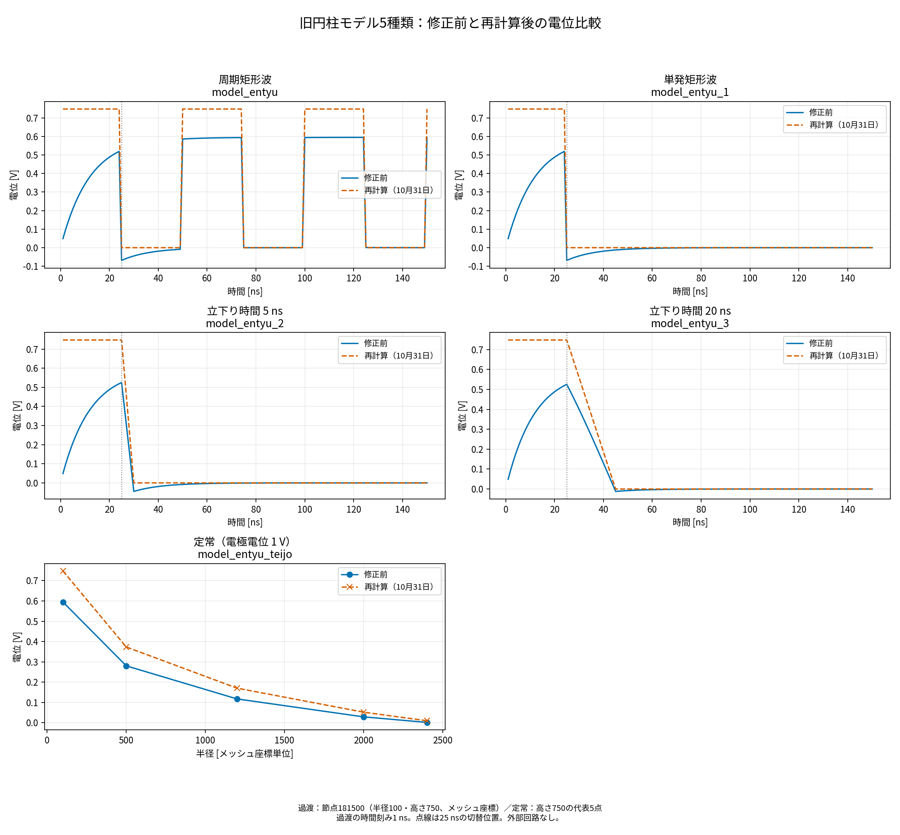

# 旧円柱モデルの再計算・過去結果比較（2026年10月31日）

旧円柱モデル5種類を、2026年10月29日の修正を含むソースからビルドした通常プログラムで再計算した。過去の出力は上書きしていない。入力は models/ に複製し、ハッシュを input_hashes.json に記録した。元のメッシュ・材料・パルス・時間条件と追加済みの symmetry.dat を使用し、circuit.dat は追加していない。過渡モデルのOFFは電極の0 V固定であり、電源切り離し放電ではない。

## 結果

| モデル | ステップ | 過去の全領域最小電位 [V] | 今回の全領域最小電位 [V] | 全節点・全時刻の最大絶対差 [V] |
|---|---:|---:|---:|---:|
| model_entyu | 150 | -7.988100e-02 | -4.807400e-11 | 7.019160e-01 |
| model_entyu_1 | 150 | -7.988100e-02 | -4.807400e-11 | 7.019160e-01 |
| model_entyu_2 | 150 | -5.208400e-02 | -4.018300e-11 | 7.019160e-01 |
| model_entyu_3 | 150 | -1.445200e-02 | -2.264700e-11 | 7.019160e-01 |
| model_entyu_teijo | 1 | -1.692700e-04 | 0.000000e+00 | 1.936500e-01 |

4種類の過渡解析は各150ステップ、定常解析は1ステップで完了。全モデルの最終線形求解は収束し、実行ログに警告・未収束・入力エラーはない。各ステップの全363,759節点の保存値を比較した。

高さ方向に同じXY座標を持つ節点の電位は、今回の全モデル・全出力ステップで完全一致した。今回の小さな負値は数値誤差水準であり、値の切り上げ・平滑化は行っていない。

## 節点181500（r=100、z=750）の25 ns時点

| モデル | 過去 [V] | 今回 [V] |
|---|---:|---:|
| model_entyu | -6.875000e-02 | -1.637500e-12 |
| model_entyu_1 | -6.875000e-02 | -1.637500e-12 |
| model_entyu_2 | 5.252200e-01 | 7.476800e-01 |
| model_entyu_3 | 5.252200e-01 | 7.476800e-01 |



過渡4条件は節点181500（半径100・高さ750、メッシュ座標）の時間応答、定常条件は同じ高さの代表5点の半径分布を示す。破線は10月31日の再計算結果で、修正前に見られた負電位が数値誤差水準まで減少している。

## 10月26日の中間修正結果との比較

初期条件・勾配変換を修正済みで、高さ方向の同一電位条件を使っていなかった10月26日の結果とも比較した。単発パルス・5 ns立下り・20 ns立下りは解析区間内の入力波形が一致する。

| モデル | 10月26日の全領域最小電位 [V] | 今回 [V] |
|---|---:|---:|
| model_entyu_1 | -1.679600e-04 | -4.807400e-11 |
| model_entyu_2 | -1.489000e-04 | -4.018300e-11 |
| model_entyu_3 | -9.513900e-05 | -2.264700e-11 |

初期実装の旧結果との差は勾配変換・初期条件・対称性条件など複数の修正を含む。10月26日結果との比較では、残留していた端面付近の負電位が数値誤差水準まで減少することを確認できる。定常モデルはパルスOFFを扱わず、修正後の空間電位分布を比較した。

## 保存資料

- [モデル別集計](summary.csv)
- [10月26日との時系列比較](comparison_with_20261026.csv)
- [比較図（SVG）](before_after.svg)
- 各 output/<モデル名>/comparison_timeseries.csv：全領域の最小値、最大差、RMS差、代表5節点の新旧電位。
- 各 output/<モデル名>/old_output_sha256.json：比較した旧出力のSHA256。
- run.log、build.log、batch_summary.csv、ソース複製、入力複製を同じフォルダに保存。

比較数値は tempa.dat の出力精度（有効数字5桁）に基づく。微小電位の値も保存値から集計している。実回路との比較や外部抵抗・容量の同定は今回の対象外。


## グラフ表記の更新（2026-11-06）

タイトル・軸・凡例・条件説明を日本語に統一しました。保存済みの数値データから図のみを再生成し、解析結果の数値・結論は変更していません。
図だけを更新する場合は、プロジェクトルートで次を実行してください。

```bash
python3 tools/localize_report_graphs.py
```

### 補足の比較図

- [単発パルス：修正段階の比較](node181500_single_pulse_comparison.png)
- [立下り20 ns：修正段階の比較](node181500_fall20_before_after.png)
- [電源OFF方法の比較](node181500_gradual_decay.png)

いずれも節点181500の電位履歴です。前2図は修正前・10月26日・10月31日の結果を比較し、最後の図は瞬時の0 V固定、20 nsの電圧立下り、電源切り離し放電を比較します。
