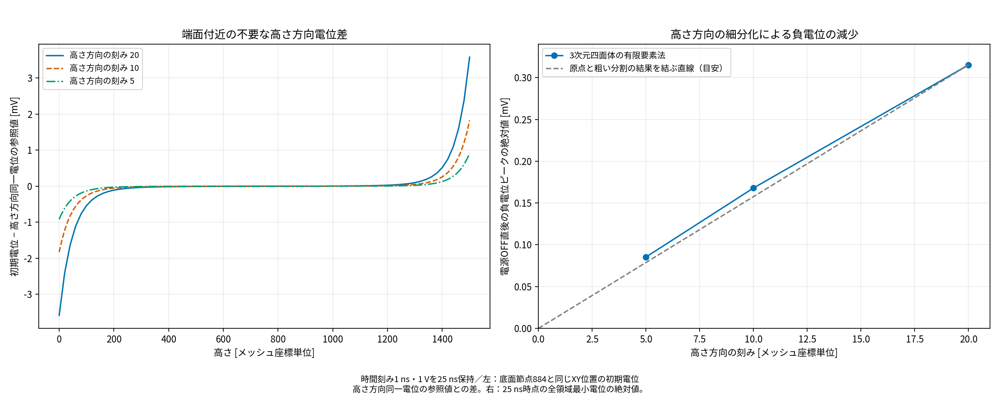

# 残留負電位の原因究明とFortran版との比較（2026-10-29）

> 2026-10-29実装追記：高さ方向の同一電位と電源・放電回路の結合を通常のプログラムへ実装し、正の電位から0 Vへ減衰する円柱例を検証しました。[実装・検証結果](../poweroff_implementation_20261029/report.md)を参照してください。

## 結論

修正後に残った約−0.168 mVの負電位は、今回のモデルでは物理的な電源OFF応答として扱うべきではない。**一次四面体FEMの端面付近の空間離散化誤差が、本来不要な高さ方向の電位変化を作り、その誤差が導電率の異方性によって過渡成分として現れている**と判断する。

この判断は、同じ時間刻みでの空間細分化、等方物性への対照変更、高さ方向同一電位の参照計算、Fortran実ソースの要素計算・全体残差評価による。元の入力と10月26日の出力は保持し、本体のC++ソースと実行ファイルは今回変更していない。

## なぜ理論上は負電位にならないのか

対象はXY断面が高さ方向に同じ押出し形状。材料界面も垂直で、電極電位は高さに依存せず、端面は零流束である。媒質の導電率は(0.01, 0.01, 0.008)、誘電率は全方向1e-10。初期自由電荷なし、電流ソース0。

断面内でΔ_xy h=0、内側電極h=1、外側電極h=0となるh(x,y)を考えると、

```text
phi(x,y,z,t) = V(t) h(x,y)
```

は導電項と変位電流項の両方を満たす。z方向微分は0なので、sigma_zとsigma_xの差も影響しない。0<=h<=1、0<=V<=1なら負電位にはならず、V=0なら内部も0になる。

## 確認した原因の連鎖

1. 初期誘電場を三次元の一次四面体で解くと、同じXY位置なのに高さ方向で最大約3.656 mVの電位差が現れる。本来の連続体解にはない差である。
2. 高さ方向に一定の二次元参照解を三次元メッシュへ持ち上げると、誘電率行列の自由節点残差は端面で約3.108e-11、内部で約2.600e-20となった。離散式の不整合は端面に集中している。
3. この数値的なz方向勾配に対し、誘電率は等方、導電率はz方向だけ0.8倍なので、離散誘電場と離散導電定常場が一致しなくなる。基準メッシュで両者の最大差は約0.2124 mV。
4. ON中に、その差分が過渡成分として形成される。節点884では24 ns時点で、初期誘電場から−0.18224 mVだけ変化していた。
5. 電極を0 Vにすると入力に直接対応する場が消え、この差分が残る。25 nsの節点884は−0.16796 mVとなり、その後減衰する。

行列で書くと、初期誘電場h_Eは自由節点でK_epsilon h_E=0を満たす。一方、数値的なz方向変化があるためK_sigma h_Eは0にならない。u=h_E+wと書いたとき、ON中のwの式には−K_sigma h_Eが駆動項として現れる。OFF後の計算結果は主にこのwが残ったものである。

今回の四面体メッシュは、端面付近で高さ方向に一様な離散解を厳密には保持しない。四面体の近似空間と端面付近の試験関数の積分重みが影響する。形状が押出し形状であるだけで、三次元一次四面体の解が断面の二次元解と厳密に一致するとは限らない。

## 原因を切り分けた計算

全ケースでdt=1 ns、High=25 ns、0〜26 nsを計算。26ステップすべて収束警告0件。

| 条件 | 節点数 | 高さ方向の刻み（元座標） | 初期場の高さ方向差 [mV] | OFF直後の全領域最小値 [mV] |
|---|---:|---:|---:|---:|
| 三次元・粗い分割 | 183084 | 20 | 7.16801 | -0.315245577 |
| 三次元・元の分割 | 363759 | 10 | 3.65586 | -0.167961668 |
| 三次元・細かい分割 | 725109 | 5 | 1.83731 | -0.0853810329 |
| 同じ三次元分割・導電率を等方に変更 | 363759 | 10 | 3.65586 | -6.65278958e-08 |
| 同じXY節点を高さ方向に同一電位へ拘束 | 2409 | 0 | 0 | -3.12195599e-08 |

高さ方向の刻みを20→10→5にすると、負電位の絶対値は約0.315→0.168→0.0854 mVと、ほぼ半分ずつ減る。初期場の不要なz方向差も約7.168→3.656→1.837 mVと減る。時間刻みは同じなので、空間離散化の影響を切り分けられている。

等方物性への変更は原因切り分けの対照試験であり、実際の異方性物性を置き換える対策ではない。等方にすると初期場のz方向誤差は残るが、導電率・誘電率の自由節点の行列が比例するため、過渡的な負電位は約6.7e-11 Vまで消える。

高さ方向同一電位の参照計算では元の異方性物性を維持したまま、約3.1e-11 Vまで消えた。これは負電位を切り捨てた結果ではなく、同じXY位置の自由度をまとめて行列を縮約し、理論上の対称性を課して解いた結果である。



左は底面節点884と同じXY位置の初期電位を高さ方向に比較し、同一電位拘束を課した参照値との差を示す。右は25 nsの全領域最小電位の絶対値で、高さ方向を細分化するほど負電位が小さくなる。灰色の破線は傾向を比較する目安である。

## メッシュ接続の点検

全2,095,200要素で、XY平面への射影は3点からなる三角形。電極材料1・3の側面三角形はすべてz方向法線成分0で、傾斜した材料界面はない。

最初の1層13,968要素について、要素面の対応を点検した。端面9,312面、外側面320面で、内部に対応相手のない面は0、3要素以上が共有する面も0だった。さらに全150層で同じ接続・材料配置が繰り返されることを確認した。今回の現象を、単純な面接続漏れや材料の傾斜で説明する証拠はない。

## Fortran版を何に使ったか

参照先：`/home/ohkura/program/femeemt.ver5.4.2+ohkura_2`。電位解析向けのworktree側にも同じ要素計算を確認した。

- `_Fem/cdecal.f90`：余因子による四面体の勾配・体積係数。
- `_Fem/gtemp.f90`：gtemp0が導電率行列。実際に使われるgtemp2は勾配型の誘電率行列/dt。熱拡散の質量行列gtemp1はmkmatrixでコメントアウトされている。
- `_Fem/mkmatrix.f90`、`_Fem/renew.f90`：電位の補正量を解いて加算する方式。整理するとC++と同じBackward Euler式になる。
- `_Module/nodes.f90`：前ステップ値temp0への保存を確認した。

```text
Fortranの補正量形式：
(K_sigma + K_epsilon/dt) delta_u
    = F - K_sigma u_current - (K_epsilon/dt)(u_current-u_previous)
u_new = u_current + delta_u

整理後：
(K_sigma + K_epsilon/dt) u_new = F + (K_epsilon/dt)u_previous
```

**Fortranの実際のcdecal・gtempをコンパイルして比較した。** 最小限のデータモジュールと検証ドライバを用意し、要素の式自体は変更していない。

64要素・2,048成分の比較では、元座標での行列の相対最大差は約2.4e-11。各要素の座標原点を移して余因子計算の桁落ちを減らすと、約4.7e-16で一致した。この差は約1e-4 Vの残留負電位の原因にはならない。

さらに全363,759節点・2,095,200要素をFortranの実要素ルーチンで組み立てて、C++で求めたOFF直後の場を検査した。自由節点のBackward Euler式の残差L2/RHS L2は約1.93e-7だった。大きなON電位から微小なOFF応答を求める差し引きと、余因子計算の桁落ちがある条件でも、離散式の一致を確認できた。

Fortran版全体のパルス解析を同じ条件で走らせたという検証ではない。実要素計算と時間更新式を比較した結果であり、同じ四面体・同じ物性・同じ境界条件・同じ初期状態の離散式を解く限り、言語をFortranへ替えるだけでは空間離散化誤差はなくならない。

### 入力形式の違い

Fortranのgtemp2はrhoを相対誘電率としてepsilon0を掛ける。一方、C++の6列物性は絶対誘電率。例えばC++の1e-10 F/mをFortranへ与えるときは、rho=1e-10/8.854187e-12と変換する必要がある。元Fortranの物性入力は5列、C++は6列で、境界typeの意味も異なる。入力ファイルの単純な流用は比較にならない。

Fortranは座標をヘッダーのfactで割るが、現C++はその換算を適用していない。今回は全体行列の共通のスケール差を揃えて比較した。零電流ソース・指定電圧条件での電位と緩和時間は、一様な座標スケール変更では変わらない。

## 判断と対策

今回残った負電位の主因は、三次元一次四面体の端面誤差と異方性の組合せである。電源OFF時の物理的な逆電位を立証する結果としては使えない。

このモデルのように高さ方向に形状・材料・電極条件が一様なら、高さ方向同一電位を明示した二次元相当の解析が適切な参照になる。一般の三次元解析では、端面付近の空間細分化、押出し形状に適したプリズム要素等の離散化を検討し、空間収束を確認する。今回の結果から、時間刻みだけ細かくしても問題が解決しなかった理由を説明できる。

なお、今回の結果は高さ方向の空間収束であり、一般の三次元形状や任意の不均質媒質へ「負電位は常に不正」と一般化するものではない。

## 検証ファイル

- [5条件の比較CSV](cause_summary.csv)
- [生産コードとの照合と節点追跡](verification.json)
- [形状・界面の点検](extrusion_geometry.json)、[面接続の点検](conformity_first_layer.json)
- [Fortran要素行列比較](fortran_kernel/comparison.json)、[Fortran全体残差](fortran_full/residual.txt)
- [入力・ソース記録](manifest.json)
- 各条件のフォルダにphi0.bin、phi24.bin、phi25.bin、phi_steady.bin、history.csv、initial_metrics.txt、run.logを保存した。
- 検証コード：tools/poweroff_operator_probe.cpp、tools/compare_fortran_elements.cpp、tools/fortran_full_residual.f90、tools/diagnose_extrusion.py、tools/summarize_operator_probe.py。

元のRCM並替え付き計算と、今回の入力順での独立した時間更新を比較すると、25 nsの全節点電位差は従来出力の丸め幅内（最大約3.7e-9 V）だった。5条件はすべて26ステップを完走し、収束警告0件。


## グラフ表記の更新（2026-11-06）

タイトル・軸・凡例・条件説明を日本語に統一しました。保存済みの数値データから図のみを再生成し、解析結果の数値・結論は変更していません。
図だけを更新する場合は、プロジェクトルートで次を実行してください。

```bash
python3 tools/localize_report_graphs.py
```
