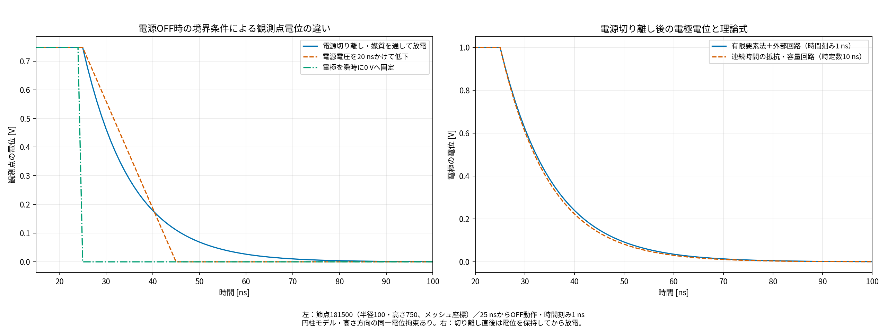

# 電源OFFモデルの実装と検証（2026-10-29）

高さ方向の同一電位と、電源・放電回路との結合を通常の解析プログラムに実装した。電源を切り離す場合と、接続を保って電圧を低下させる場合を入力で使い分けられる。

## 結果

- 切り離し放電：25 nsの電極電位は1 Vを保持し、26 nsから正のまま減衰した。全150ステップの領域最小値は0 V（接地電極を含む）。
- 電圧立下り：既存モデルの25〜45 nsの立下りに合わせて内部電位も低下した。残る負値は約2.3e-11 Vの数値誤差水準。
- 瞬時0 V固定：従来のように直ちに0 Vへ変わる比較条件。残る負値は約4.8e-11 Vの数値誤差水準。
- 高さ方向に同じXY位置の出力電位は、確認した各時刻で完全に一致した。3ケースとも363,759節点・2,095,200要素、150ステップを完走し、収束警告0件。



左は節点181500の電位を3種類の電源OFF条件で比較する。右は切り離し後の電極電位を時定数10 nsの連続時間の抵抗・容量回路の理論式と比較し、電位を保持してから正のまま放電することを示す。

## 切り離し放電の参照条件

外部放電抵抗の値が未提示なので、参照例では外部抵抗・追加容量を置かず、導電性の媒質そのものを通って外側接地電極へ放電する。実測した外部抵抗や出力抵抗の影響は、値を入力してから評価する。

媒質のε/σ_xyから時定数は10 ns。dt=1 nsの後退Euler法の理論値と、電極電位は最大差1.9984014443252818e-14 Vで一致した。25 nsの開放瞬間には電荷を保持し、次の区間から放電を計算する。

連続時間の指数関数との違いは時間積分誤差である。dt=1 nsでは1ステップごとに1/1.1を掛ける減衰となる。電位を目標曲線へ加工しているわけではない。

長さ換算0.001（Fortranのfact=1000に合わせた参照規約）での実効容量は約2.185195723905246e-10 F、媒質の実効抵抗は約45.76249116087698 Ω。外部抵抗を接続すれば、その並列導電経路と追加容量を含めて時定数が変わる。

## 実装した内容

1. symmetry.dat：同じXY座標の節点を同一電位へまとめ、縮約したFEM行列を解く。材料・境界・押出し形状の条件を検査し、元の全節点順に展開して保存する。
2. circuit.dat：対象電極を一つの未知電位にし、電源抵抗・放電抵抗・追加容量と導電電流／変位電流のKCLを結合する。回路を指定しない場合のpulse.datは従来の固定電位条件。
3. initial_state：無自由電荷の誘電場、または開始前から通電した導電定常場を選択。OFF時に内部電位・電荷をリセットしない。
4. circuit_history.csv：初期状態と各ステップの電極電位・接続先基準電位・電荷・抵抗枝電流を保存。
5. 高導電率電極の自由度をまとめる際の相殺誤差が偽の接地抵抗にならないよう、勾配行列が定数電位を消す性質を保って縮約する。

負電位の切り上げ、波形の平滑化、結果の後処理による指数関数への置換は行っていない。

## 使用方法

```bash
./fem model_entyu_open
./fem model_entyu_fall_sym
./fem model_entyu_clamp_sym
```

それぞれoutput/モデル名/へ出力する。元の解析結果は保持した。元の円柱モデル5種類にも、確認済みのsymmetry.datを追加しているが、元の出力フォルダは再計算していない。

詳しい設定と制約は[使い方](../../electrical_circuit.md)を参照。回路結合は単一電極・一度の切り離し・過渡解析に対応する。切り離し時刻は時間格子上に置く。任意の初期電荷ファイルや途中からの再開は未対応。

## 検証記録

- [円柱モデルの指標](implemented_results.json)
- [既存物理回帰試験](physics_regression.log)
- [回路・電荷保存・切替連続性等の試験](circuit_regression.log)
- [設定ファイルの正常・異常系試験](electrical_cli_checks.json)
- 各モデルのoutputフォルダにanalysis_summary.txt、全節点電位、probe_timeseries.csvを保存。切り離しモデルにはcircuit_history.csvも保存。

実機の抵抗・容量・電源立下り波形への同定はまだ行っていない。参照例の正の減衰を、実機の減衰時間と一致した結果として扱うものではない。


## グラフ表記の更新（2026-11-06）

タイトル・軸・凡例・条件説明を日本語に統一しました。保存済みの数値データから図のみを再生成し、解析結果の数値・結論は変更していません。
図だけを更新する場合は、プロジェクトルートで次を実行してください。

```bash
python3 tools/localize_report_graphs.py
```
