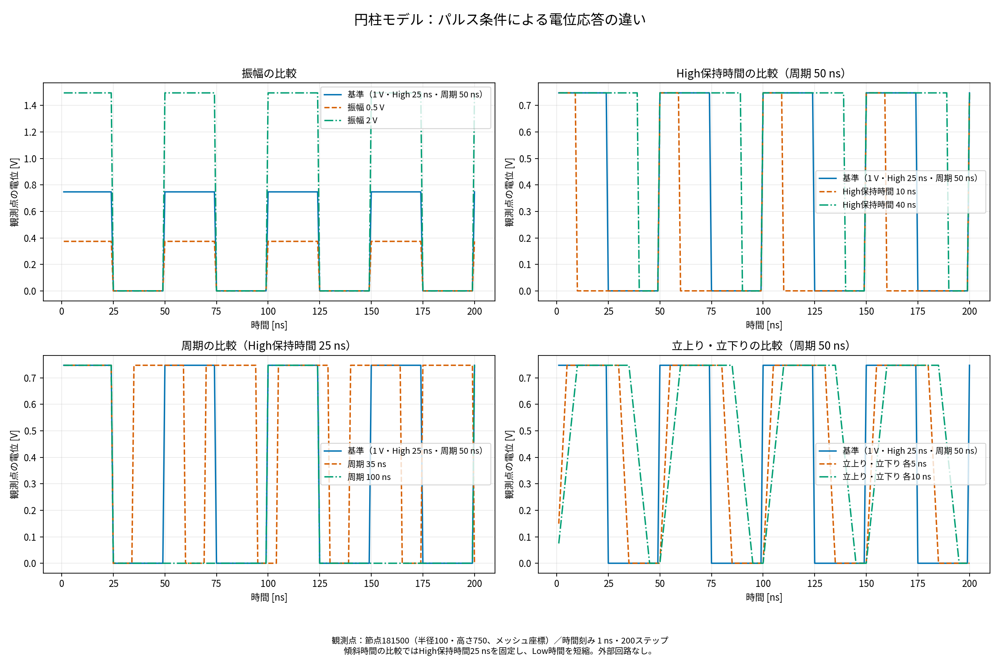

# パルス条件比較解析報告書

作成日：2026年11月4日

## 主な結果

9条件・合計1,800ステップを完走した。節点181500の最大電位は基準条件で0.74768 V、振幅0.5 Vで0.37384 V、2 Vで1.4954 Vとなり、出力丸めの範囲で振幅に比例した。High時間を10 nsから40 nsへ延ばすと、200 ns平均電位は0.149536 Vから0.598144 Vへ増加した。今回の理想電圧駆動では、内部電位は入力波形にほぼ直接追従する。

## 解析対象と目的

作業フォルダの既存資料と入力を確認し、パルス・理論検証に使用されている円柱モデル `models/model_entyu` を選定した。対象の指定がなかったための選定であり、他形状の解析結果ではない。振幅、High保持時間、周期、立上り・立下り時間の影響を、一度に一種類の条件を変更して比較した。

## 共通条件

363,759節点、2,095,200四面体要素。既存の材料、接地境界、電極配置、高さ方向の同一電位拘束を保持。媒質の面内導電率0.01 S/m、軸方向0.008 S/m、誘電率1e-10 F/m。後退Euler法、時間刻み1 ns、200ステップ、解析期間200 ns。初期状態は開始時の電圧に対応した無自由電荷の誘電場であり、矩形波では開始時からHighである。

回路結合は使用せず、Low期間は電極を0 Vへ固定する。電源切り離し放電とは条件が異なる。空間スケールの単位は追加仮定せず、電位[V]と時間[ns]を比較する。絶対電場・電流・エネルギーは評価していない。

## 条件と計算結果

基準は振幅1 V、High 25 ns、Low 25 ns、周期50 nsの矩形波。幅変更では周期50 nsを、周期変更ではHigh 25 nsを保持。緩やかな波形ではHigh保持25 nsを保持し、Low時間を短縮して周期50 nsを維持した。このため傾斜時間比較には電圧時間積分とLow時間の変化も含まれる。パルス幅は本表ではHigh保持時間を意味する。

|条件|振幅 V|立上り ns|High ns|立下り ns|Low ns|周期 ns|観測点最大 V|平均 V|RMS V|
|---|---:|---:|---:|---:|---:|---:|---:|---:|---:|
|baseline|1|0|25|0|25|50|0.7476800|0.3738400|0.5286896|
|amplitude_half|0.5|0|25|0|25|50|0.3738400|0.1869200|0.2643448|
|amplitude_double|2|0|25|0|25|50|1.4954000|0.7477000|1.0574075|
|width_short|1|0|10|0|40|50|0.7476800|0.1495360|0.3343727|
|width_long|1|0|40|0|10|50|0.7476800|0.5981440|0.6687453|
|period_short|1|0|25|0|10|35|0.7476800|0.5570216|0.6453479|
|period_long|1|0|25|0|75|100|0.7476800|0.1869200|0.3738400|
|edge_5ns|1|5|25|5|15|50|0.7476800|0.4486080|0.5634947|
|edge_10ns|1|10|25|10|5|50|0.7476800|0.5233755|0.5953331|

平均とRMSはt=1〜200 nsの200サンプルから計算した。初期値は含まない。周期35 nsの条件は観測期間が整数周期でないため、平均値には窓長の影響が含まれる。観測点は節点181500（既存資料のr=100位置）。4節点の履歴を各ケースのCSVへ保存した。



各パネルは振幅、High保持時間、周期、立上り・立下り時間の影響を示す。観測点は節点181500（半径100・高さ750、メッシュ座標）。振幅は最大電位に、保持時間・周期は平均電位に影響する。

## 考察

振幅0.5倍・2倍の4観測点で、基準波形を同倍率にした値との差は最大4.000e-05 Vであった。今回の線形な材料・境界条件では、電位応答は振幅に比例する。

High保持時間の変更結果：width_shortの平均は0.149536 V、RMSは0.334373 V、width_longの平均は0.598144 V、RMSは0.668745 V（基準平均0.373840 V、RMS0.528690 V）。

周期の変更結果：period_shortの平均は0.557022 V、RMSは0.645348 V、period_longの平均は0.186920 V、RMSは0.373840 V（基準平均0.373840 V、RMS0.528690 V）。

立上り・立下り時間の変更結果：edge_5nsの平均は0.448608 V、RMSは0.563495 V、edge_10nsの平均は0.523376 V、RMSは0.595333 V（基準平均0.373840 V、RMS0.528690 V）。

この一様な円柱条件では面内の誘電率／導電率が共通なので、理想電極の電圧変化が内部電位に直接反映される。短パルスで内部が必ず時定数に従ってゆっくり充電される、という回路応答をこの固定電圧条件へ当てはめることはできない。残留放電や電源抵抗による波形の遅れを調べる場合は、既存のcircuit.datを用いた別条件が必要となる。

## 検証と制約

全9条件で200ステップの出力を確認し、観測値の有限性、ログの警告なしを検査した。振幅比例性は4観測点で照合した。これらは実行整合性の検査であり、メッシュ・時間刻みの収束試験や実測との照合ではない。1 ns未満の過渡や絶縁破壊・非線形材料・発熱は本報告の評価対象外。出力の微小負値は加工せずsummary.csvへ領域最小値として記録した。

## 再現と保存先

`python3 output/pulse_study_20261104/run_study.py` で再実行できる。現在のソースを専用バイナリにビルドし、専用フォルダ内で実行する。既存入力・結果・ルートのbatch_summary.csvは変更しない。再実行時は本比較解析の結果を上書きする。

- manifest.json：使用ソースのSHA-256、基準モデル、条件一覧
- models/条件名/：各ケースの実入力
- output/条件名/：全節点200ステップ、analysis_summary.txt、probe_timeseries.csv
- 条件名.log：実行ログ
- summary.csv：条件・指標・実行時間
- comparison.png：比較グラフ

## 追加検証と空間精度の注意点

各条件の1・100・200ステップ（計27個の全節点ファイル）を読み、363,759個の電位が有限値であること、および同じXY座標の高さ方向151層で電位差が0 Vであることを確認した。既存の物理回帰試験も通過した（physics_regression.log）。検査記録はadditional_checks.jsonに保存した。

既存の[同じ円柱モデルの理論比較](../cylinder_theory_validation_20261102/report.md)では、代表点の電位に約6.77〜7.32%の過大評価が報告されている。今回も節点181500の1 V入力時の最大電位0.74768 Vに対し、半径a=25、b=2500、観測半径r=100の連続同軸円筒理論値はln(2500/100)/ln(2500/25)=0.698970 Vで、約6.97%高い。今回の結果は条件間の相対比較に使用できるが、絶対電位の高精度評価にはメッシュ改善と収束確認が必要である。

保存電位は指数表記の有限桁出力であり、2 V条件と1 V条件の単純な倍率比較には最大4e-5 V程度の丸め差が含まれる。微小負電位は全条件で絶対値1e-10 V未満であり、有意な負電位の発生として解釈しない。


## グラフ表記の更新（2026-11-06）

タイトル・軸・凡例・条件説明を日本語に統一しました。保存済みの数値データから図のみを再生成し、解析結果の数値・結論は変更していません。
図だけを更新する場合は、プロジェクトルートで次を実行してください。

```bash
python3 tools/localize_report_graphs.py
```
