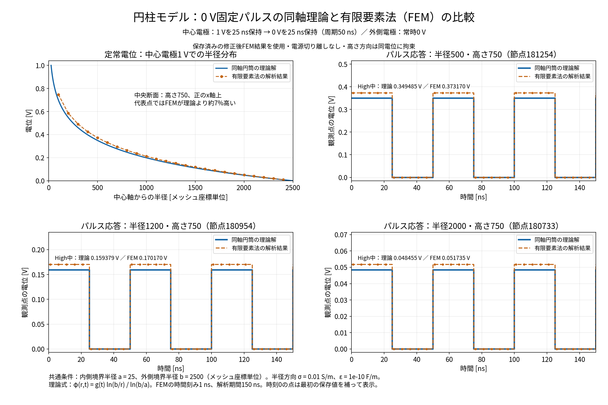

# 0 V固定パルス：同軸理論とFEMの比較

作成日：2026-11-06

## 比較条件

対象は修正後の `model_entyu`。中心電極を1 Vで25 ns、0 Vで25 nsに固定し、周期50 nsを繰り返す。外側電極は常時0 V。電源切り離しと外部回路結合は使用しない。時間刻み1 ns、解析期間150 ns、高さ方向は同一XY座標の節点を同電位に拘束する。

同軸理論は `φ(r,t)=g(t) ln(b/r)/ln(b/a)`。内側境界半径a=25、外側境界半径b=2500、長さはメッシュ座標単位。媒質の半径方向導電率0.01 S/m、絶対誘電率1e-10 F/mとする。無自由電荷で境界に整合した初期状態、一様な半径方向物性、高さ・周方向に電位変化がない連続円筒が理論の前提である。

FEMは数値解として比較する。保存済みの[11月2日の理論検証](../cylinder_theory_validation_20261102/report.md)のCSVを使用し、ソルバーは再実行していない。

## 比較図と結果

青実線が同軸理論、橙の丸印・破線がFEMの解析結果。左上は高さ750、正のx軸上の定常電位分布である。他の3枚は半径500、1200、2000、高さ750の観測点における過渡電位を示す。時間応答は計算時刻の値を階段表示し、時刻0は最初の保存値で補った。

| 半径（メッシュ座標単位） | High中の理論 [V] | High中のFEM [V] | 定常FEMの理論に対する相対差 |
|---|---:|---:|---:|
| 500 | 0.349485 | 0.373170 | +6.777% |
| 1200 | 0.159379 | 0.170170 | +6.770% |
| 2000 | 0.048455 | 0.051735 | +6.769% |

High・Lowの切替タイミングと波形の形は理論に整合し、Low期間の電位はほぼ0 Vとなる。一方、High中のFEM電位は約6.77%高く、空間分布の誤差が残る。これは理論値を分母とする相対差である。元の検証で集計されたOFF時の全領域最大絶対電位は約6.34e-11 Vである。

今回の図示で空間誤差の原因を確定することはできない。電極付近や周方向のメッシュ収束は未確認であり、開放放電・実測波形との比較も対象外である。

## 成果物と再現

- [PNG](comparison.png)・[SVG](comparison.svg)
- [定常中央断面CSV](steady_centerline.csv)・[パルス時系列CSV](pulse_timeseries.csv)
- [生成スクリプト](plot.py)：プロジェクトルートで `python3 output/pulse_theory_comparison_20261106/plot.py` を実行。
- 出典：[時系列CSV](../cylinder_theory_validation_20261102/timeseries.csv)、[全自由節点の定常CSV](../cylinder_theory_validation_20261102/steady_all_free_nodes.csv)。

Noto Sans CJK JPを明示し、欠字警告がないことと保存画像の文字・凡例・配置を確認した。
