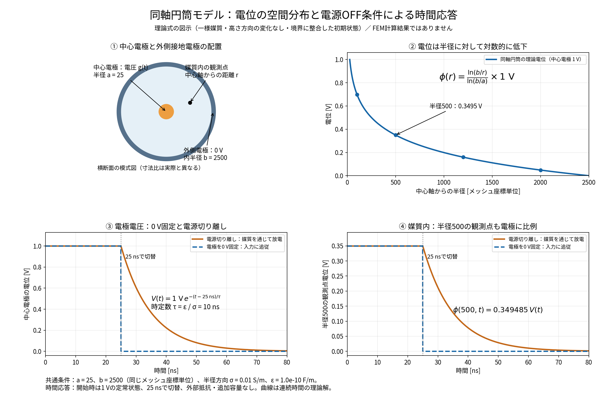

# 同軸円筒の理論解の図解

作成日：2026-11-06

同軸円筒の空間分布と、電源OFFの境界条件による時間応答の違いを図示した。FEMの再計算や既存結果の変更は行っていない。

## 図の読み方

1. 左上は横断面の模式図。中心電極の外半径a=25、外側接地電極の内半径b=2500とする。模式図の寸法比は実際とは異なる。
2. 右上は中心電極1 Vのときの理論電位 `φ(r)=ln(b/r)/ln(b/a) × 1 V`。半径500では約0.349485 Vとなり、外側接地電極に向けて対数的に低下する。
3. 左下は中心電極の電位。初期状態を1 Vの定常状態とし、25 nsで0 Vへ固定すると直ちに0 Vとなる。電源を切り離した場合は、その瞬間の電圧を保持してから媒質を通じて指数関数的に放電する。
4. 右下は半径500の媒質内電位。今回の条件では電極電圧の0.349485倍であり、電圧固定中に独立した一次遅れを付加する必要はない。

## 仮定と適用範囲

一様な半径方向物性、同軸境界、高さ・周方向の電位変化なし、境界条件に整合した初期状態を仮定する。長さはメッシュ座標単位で統一し、絶対長さのSI換算を必要とする電流値・電場値は図示していない。

半径方向の導電率は0.01 S/m、絶対誘電率は1e-10 F/mで、電荷緩和時間は `τ=ε/σ=10 ns`。外部抵抗・追加容量は置かない。開放後の連続時間解は `V(t)=V(25 ns) exp(-(t-25 ns)/τ)` となる。図は連続時間の理論式から作成しており、後退Euler法の離散解やFEMの空間誤差は含まない。

最新の保存済みFEMとの比較では代表点に約7%の空間誤差が残るため、この図をFEMとの完全一致の証拠とは扱わない。

## 参照・成果物

- [円柱モデルの理論検証](../cylinder_theory_validation_20261102/report.md)
- [回路・対称性の説明](../../docs/electrical_circuit.md)
- [画像（PNG）](theory_overview.png)・[ベクトル画像（SVG）](theory_overview.svg)
- [半径分布CSV](radial_theory.csv)・[時間応答CSV](time_theory.csv)
- [生成スクリプト](plot.py)：プロジェクトルートで `python3 output/theory_illustration_20261106/plot.py` を実行。

日本語フォントはNoto Sans CJK JPを明示指定し、欠字警告がないことと保存画像の表示を確認した。
